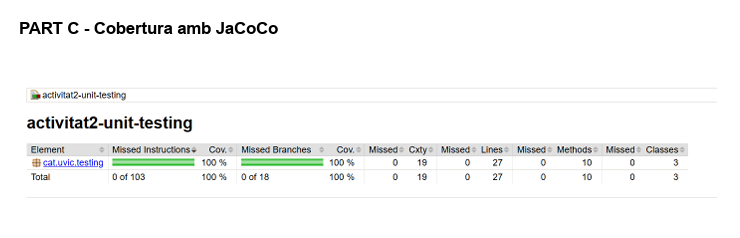
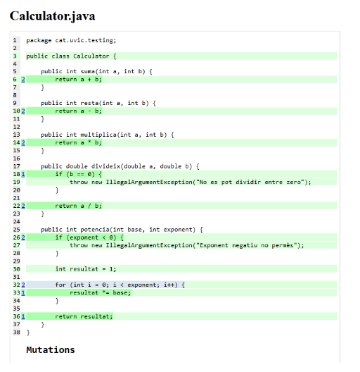
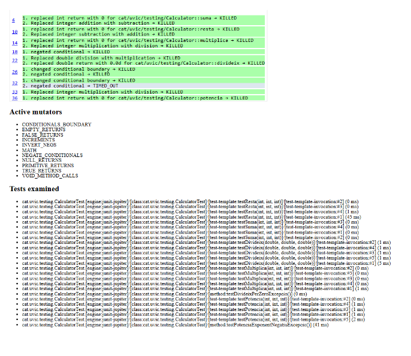
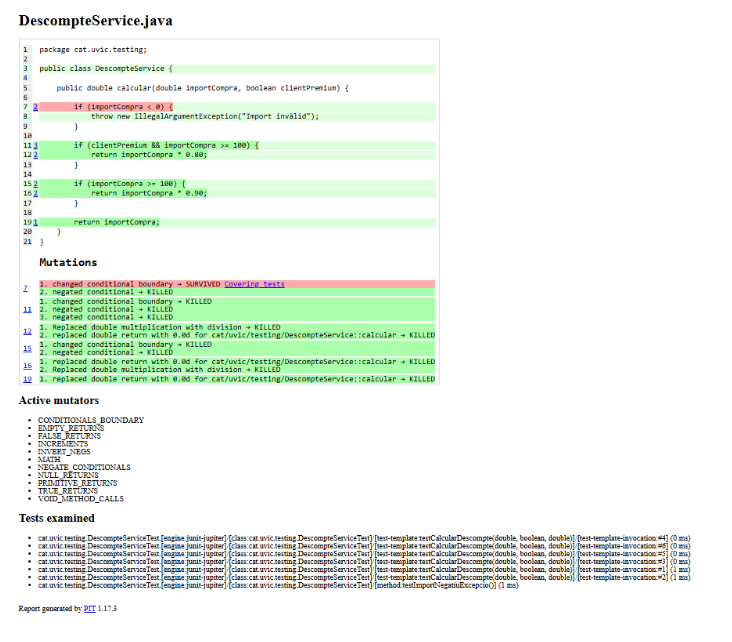
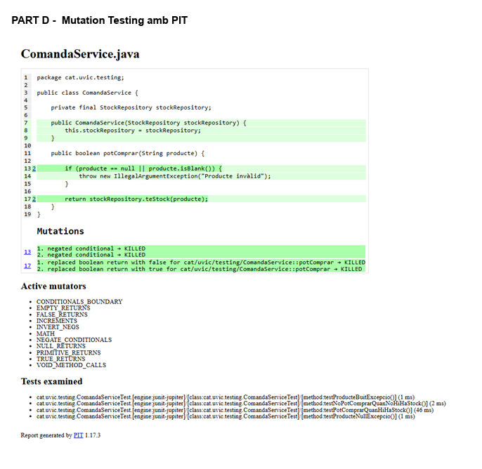

# Activitat 2 - Unit Testing, Cobertura, Mutation Testing i Mockito

Aquest projecte serveix com a plantilla base (*starter*) per a la pràctica de proves unitàries a Java. L'objectiu principal és aprendre i aplicar les tècniques fonamentals de verificació de programari: disseny de casos de prova amb **JUnit 5**, mesura de cobertura de codi amb **JaCoCo**, avaluació de la qualitat dels tests mitjançant **Mutation Testing (PIT)** i aïllament de dependències amb **Mockito**.

---

## 🎯 Objectius d'aprenentatge

1. **JUnit 5 bàsic i parametritzat**:
   - Escriure tests unitaris assertius (`assertEquals`, `assertTrue`, `assertThrows`, etc.).
   - Utilitzar proves parametritzades (`@ParameterizedTest`, `@CsvSource`, `@ValueSource`) per evitar duplicació de codi de test.
2. **Mesura i anàlisi de cobertura (JaCoCo)**:
   - Comprendre la cobertura de línia (*Line Coverage*) i de branca (*Branch Coverage*).
   - Identificar camins d'execució no coberts i condicions límit.
3. **Mutation Testing (PIT)**:
   - Entendre el concepte de *mutant* (canvis sintàctics automàtics al codi font) i com avaluar l'eficàcia dels tests per "matar" aquests mutants (*Mutation Score*).
4. **Dobles de prova i aïllament amb Mockito**:
   - Aprendre a aïllar una classe de les seves dependències externes mitjançant *mocks*.
   - Configurar respostes fictícies (*stubbing* amb `when(...).thenReturn(...)`).
   - Verificar interaccions i comportaments (`verify(...)`, `verifyNoInteractions(...)`).

---

## 📂 Estructura del projecte

```text
activitat2-unit-testing/
├── pom.xml                                    # Configuració Maven (JUnit 5, Mockito, JaCoCo, PIT)
├── .gitignore                                 # Fitxers exclosos de Git (target, IDEs, etc.)
├── README.md                                  # Guia del projecte
└── src/
    ├── main/java/cat/uvic/testing/            # Classes de negoci (producció)
    │   ├── Calculator.java                    # Lògica bàsica per a proves unitàries i parametritzades
    │   ├── DescompteService.java              # Lògica condicional per a cobertura de branques i PIT
    │   ├── StockRepository.java               # Interfície de dependència (accés a dades d'estoc)
    │   └── ComandaService.java                # Servei amb dependència injectable per a Mockito
    └── test/java/cat/uvic/testing/            # Paquet on l'alumnat implementarà els tests
```

---

## 📦 Classes del domini

### 1. `Calculator.java`
Conté operacions matemàtiques bàsiques (`suma`, `resta`, `multiplica`, `divideix` i `potencia`).
* **Aspectes a testejar:**
  * Resultats correctes per a valors positius, negatius i zero.
  * Llançament d'excepcions (`IllegalArgumentException`) en dividir per zero o en demanar potències amb exponent negatiu.
  * Ús de proves parametritzades (`@ParameterizedTest`).

### 2. `DescompteService.java`
Calcula el preu final aplicant regles de descompte segons l'import de la compra i si el client és *Premium* (20% per a compres $\ge 100$, 10% per a compres estàndard $\ge 100$, 0% per a imports $< 100$).
* **Aspectes a testejar:**
  * Validació d'imports invàlids (negatius).
  * Anàlisi de valors límit (per exemple: `99.99`, `100.0`, `100.01`).
  * Cobertura del 100% de branques i condicions booleanes compostes.

### 3. `StockRepository.java` & `ComandaService.java`
Representen una arquitectura desacoblada: `ComandaService` necessita comprovar si hi ha estoc d'un producte abans de permetre la compra, delegant aquesta comprovació a `StockRepository`.
* **Aspectes a testejar amb Mockito:**
  * Crear un mock de `StockRepository` i injectar-lo a `ComandaService`.
  * Simular retorn `true` / `false` del repositori i verificar el comportament de `potComprar`.
  * Comprovar que si el producte és `null` o buit, es llança `IllegalArgumentException` i **no es crida mai** al repositori (`verifyNoInteractions`).
  * Verificar que es fa exactament la crida esperada al repositori (`verify`).

---

## 📝 Tasques a realitzar per l'alumnat

L'alumnat ha de crear els següents fitxers dins de `src/test/java/cat/uvic/testing/`:

1. **`CalculatorTest.java`**: Tests unitaris i parametritzats per a totes les operacions i excepcions de `Calculator`.
2. **`DescompteServiceTest.java`**: Bateria de tests per cobrir tots els camins de decisió i resistir el mutation testing de `DescompteService`.
3. **`ComandaServiceTest.java`**: Tests amb Mockito utilitzant `@ExtendWith(MockitoExtension.class)`, `@Mock`, `@InjectMocks`, `when()` i `verify()`.

---

## 🚀 Comandes d'execució

### 1. Executar els tests unitaris
```bash
mvn test
```

### 2. Executar tests i generar l'informe de cobertura JaCoCo
```bash
mvn clean test
```
* **Ubicació de l'informe:** Obre al navegador el fitxer:
  ```text
  target/site/jacoco/index.html
  ```

### 3. Executar Mutation Testing amb PIT
```bash
mvn org.pitest:pitest-maven:mutationCoverage
```
* **Ubicació de l'informe:** Obre l'últim informe generat a la carpeta:
  ```text
  target/pit-reports/YYYYMMDDHHMM/index.html
  ```

---

## 💻 Requisits de l'entorn

* **Java JDK:** 17 o superior.
* **Apache Maven:** 3.8 o superior.
* **IDE recomanat:** IntelliJ IDEA, Eclipse o Visual Studio Code (amb l'extensió *Extension Pack for Java*).


---

INFORMES

# Part C - Cobertura amb JaCoCo

1. **Quines línies no estan cobertes?**
   Cap. A l'informe es veu que tenim el 100% de cobertura de línies (estan cobertes les 27 línies de codi del paquet `cat.uvic.testing`).

2. **Quines branques de DescompteService no s'han executat?**
   S'han executat totes les branques sense deixar-ne cap pendent (100% de branca). Els tests passen tant per la part certa com per la falsa de cada `if` (`importCompra < 0`, `clientPremium && importCompra >= 100` i `importCompra >= 100`).

3. **Quin test afegiries per cobrir una branca pendent?**
   Com que JaCoCo marca el 100% de branques, no en queda cap per cobrir. Tot i això, per quedar-me més tranquil amb els límits, afegiria un test provant `99.99` amb `clientPremium = true`, per veure que just abans dels 100 € no s'aplica cap descompte.

4. **La cobertura obtinguda et sembla suficient? Justifica-ho amb els casos provats, no només amb el percentatge.**
   Sí, la veig suficient perquè hem provat tots els casos importants: valors típics per sota de 100 €, la frontera exacta de 100 €, clients normals i premium, i també comprovem que salti l'excepció quan passem un valor negatiu (`-10.0`). No ens hem quedat només amb el número del percentatge.

# Captura de l'exercici


---

# Part D - Mutation Testing amb PIT

A la primera passada de PIT vam detectar que 1 mutant va sobreviure:

**Línia 7 (`DescompteService`):** Canvi de condició límit (`< 0` a `<= 0`) -> **SURVIVED**.
  **Per què va sobreviure?** Perquè teníem tests per a números positius i per a negatius com `-10.0`, però no havíem provat el zero exacte (`0.0`). Quan PIT va canviar la condició a `<= 0`, el mètode va fallar amb el 0 llançant una excepció que cap test va enxampar.
  **Com ho hem arreglat?** Hem afegit el cas de prova `0.0, false, 0.0` dins del `@CsvSource` a `DescompteServiceTest`. En tornar a passar PIT, el mutant ja cau eliminat (**KILLED**).

**Línia 12 (`DescompteService`):** Canvi de multiplicació per divisió -> **KILLED**.
  **Per què va morir?** Com que el mutant va canviar el càlcul del 20% de descompte (dividint en lloc de multiplicar per `0.80`), els asserts que comprovaven el resultat esperat van fallar de seguida.

### Comparació abans i després
* **Abans d'afegir el test:** 30 de 31 mutants matats (97% de cobertura de mutació).
* **Després d'afegir el valor límit 0.0:** 31 de 31 mutants matats (100% de cobertura de mutació).

# Captures de l'exercici




---

# Part E - Introducció pràctica a Mockito (ComandaService)



# Resum de la implementació i proves amb Mockito
A `ComandaService`, el mètode `potComprar` necessita consultar `StockRepository` per saber si queda estoc. Com que no volem connectar una base de dades real als tests unitaris, hem fet servir Mockito:

1. **Creació del mock:** Hem simulat el repositori fent servir `mock(StockRepository.class)`.
2. **Configuració de les respostes:**
   * Hem simulat quan sí que hi ha producte: `when(stockRepository.teStock("poma")).thenReturn(true);`
   * Hem simulat quan està esgotat: `when(stockRepository.teStock("pera")).thenReturn(false);`
3. **Comprovació d'interaccions:** Hem fet servir `verify(stockRepository).teStock(...)` per assegurar-nos que el nostre servei realment crida al repositori quan toca.
4. **Casos d'error:** Hem comprovat que si passem un producte invàlid (`null` o buit `""`), el servei llença l'excepció directament sense arribar a cridar al repositori.

Gràcies a aquests tests amb mock, PIT ha matat els 4 mutants d'aquesta classe (100% KILLED).

---

# Preguntes finals de reflexió

1. **Quina diferència has observat entre que una línia estigui coberta i que el comportament estigui ben provat?**
   Que una línia estigui coberta només vol dir que el test l'ha executat en algun moment, però no assegura que estiguem comprovant el resultat amb un bon `assertEquals`. El comportament només està ben provat si posem asseveracions que detectin si la lògica interna canvia o s'equivoca.

2. **Què t'ha aportat PIT que no t'havia mostrat l'informe de JaCoCo?**
   JaCoCo ens deia que teníem el 100% de línies i branques i semblava que el codi fos perfecte. En canvi, PIT va modificar la condició de la línia 7 i ens va fer adonar que teníem un forat als tests, ja que mai havíem provat què passava exactament amb l'import `0.0`.

3. **Quin valor límit ha estat més rellevant en DescompteService i per què?**
   El `0.0`. En fer la comprovació d'import invàlid, el canvi entre `< 0` i `<= 0` decidia si una comanda de zero euros donava error o no. Provar el `0.0` ha estat justament el que ens ha permès matar el mutant supervivent.

4. **En quin cas t'ha resultat útil el mock de StockRepository?**
   Ha anat molt bé per poder provar la lògica de `ComandaService` de forma ràpida i aïllada. Sense necessitat de tenir la base de dades feta ni dependències externes, podem controlar nosaltres mateixos si el mètode ha de retornar `true` o `false` a conveniència del test.

5. **Quin test de la teva suite consideres que aporta més valor i per què?**
   El test parametritzat `@CsvSource` de `DescompteServiceTest`. En molt poques línies ens permet validar tot el comportament del descompte: els diferents tipus de client (normal i premium), els imports normals i els punts crítics com el `0.0` i el `100.0`.